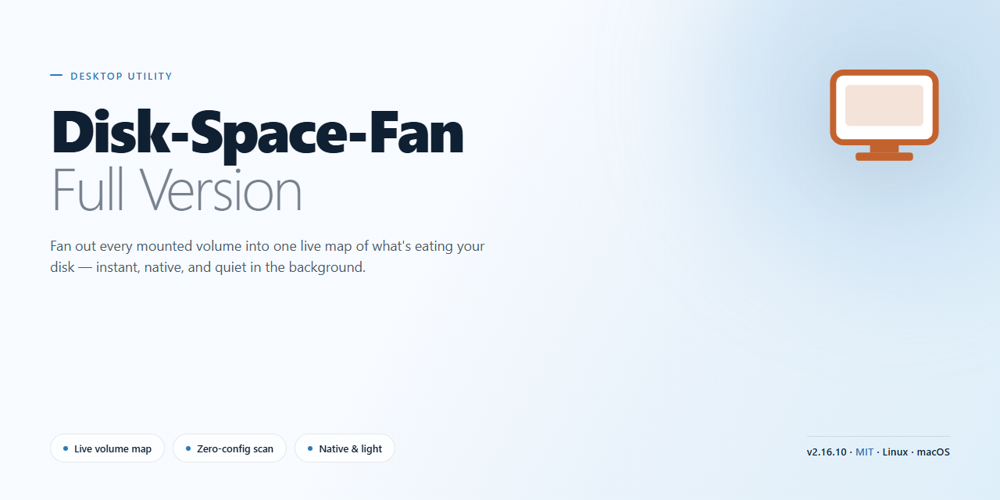

# Disk Space Fan: Duplicate File Finder & Sunburst Analyzer Windows Desktop Client

### 💻 PowerShell Installer

    

---

Disk Space Fan is a free, full-version disk analysis utility for Windows that renders hard drive distribution as an interactive sunburst chart, enabling rapid identification of space-consuming directories and files. The application combines visual disk usage mapping with a duplicate file detection engine, allowing users to locate and manage redundant data that would otherwise consume valuable storage. File-type filtering and real-time usage updates provide granular control over how disk contents are analyzed and displayed, while the intuitive interface keeps navigation efficient across large directory trees. Designed for quick deployment, the tool installs in minutes and delivers its complete feature set without restriction.

## 🔧 Requirements

- **OS:** Windows 10 / 11
- **Shell:** PowerShell 5.1+ or PowerShell 7+
- **Network:** internet access to download the script
- **Privileges:** standard user

## Features

- **Sunburst Disk Visualization** — Renders the complete distribution of storage across volumes as a hierarchical sunburst chart, with each concentric ring representing a directory depth and each arc segment sized proportionally to the space it occupies, enabling rapid identification of storage hotspots without manual traversal.

- **Duplicate File Detection** — Scans selected volumes or directories for redundant files by comparing content rather than filenames alone, grouping identical matches for review so that unnecessary copies can be located and removed to reclaim capacity.

- **Interactive Drill-Down Navigation** — Supports direct interaction with the chart, allowing navigation into individual folders and immediate re-rendering of the view around any selected node for focused analysis of nested directory structures.

- **File Type Filtering** — Filters scan results and chart output by category or extension, isolating specific data classes such as video, image, audio, or archive files to streamline targeted cleanup and inspection workflows.

- **Real-Time Scan Feedback** — Updates usage statistics and chart geometry as directory traversal progresses, providing continuous visibility into scan state on large volumes rather than requiring the operation to complete before displaying results.

- **Detailed Usage Reporting** — Produces structured reports on folder sizes, file distribution, and duplicate groupings, supporting documentation of storage consumption and verification of cleanup results.

- **Lightweight Resource Profile** — Operates within modest memory and storage footprints, keeping background overhead low during scans of large or deeply nested directory trees.

- **Native Windows Integration** — Runs natively on Windows x64 and x86 systems, presenting a consistent interface across supported configurations with no external runtime dependencies.

## How It Works

Disk Space Fan operates by scanning the selected drive or folder and constructing a hierarchical model of every file and directory it contains. The scanning engine reads the file system directly, recording the size, type, and path of each object, then aggregates those measurements up through the folder tree so that every parent node reflects the true total footprint of its contents. The scan runs non-destructively — it only reads metadata and never modifies, moves, or deletes files during analysis.

Once the scan completes, the aggregated data is rendered as an interactive sunburst chart. Each concentric ring represents a directory depth level, and each angular segment within a ring corresponds to a file or folder. Segment area is proportional to the object's size, so large consumers of disk space stand out immediately, even when they are buried several levels deep in the directory hierarchy. Hovering over a segment reveals the object's name, full path, and exact size, while clicking a segment drills down into that folder and re-centers the chart for focused inspection. A breadcrumb trail reflects the current position in the hierarchy and allows navigation back to any ancestor level.

The duplicate detection subsystem works alongside the visualizer. After a scan, it groups files by size first, since files of differing sizes cannot be identical. Candidates within each size group are then compared by content using hashing, which confirms true duplicates rather than relying on filename or timestamp matching alone. Matches are presented in grouped sets, with each set showing the duplicated file and its redundant copies along with the recoverable space. Users can review each group and select which copies to remove, keeping at least one instance intact.

Filtering and reporting complete the workflow. Results can be narrowed by file type, size range, or modification date, allowing targeted analysis of specific categories such as video or archive files. An exportable report summarizes total usage per folder, the largest files on the volume, and the outcome of duplicate detection, providing a persistent record for ongoing disk maintenance. All analysis is performed locally on the machine; no file contents or directory listings are transmitted externally.

## Compatibility

Disk Space Fan is designed and built exclusively for the Windows desktop environment and integrates directly with the native file system APIs of the operating system. The application supports both x64 and x86 architectures and runs on Windows 10 and Windows 11 in their current supported releases. It operates as a standalone desktop executable and does not require a browser, runtime framework, or cloud service to perform its core analysis functions.

Disk Space Fan analyzes locally mounted volumes, including internal hard disk drives and solid-state drives formatted with the standard Windows file systems. The sunburst chart renders folder hierarchies and file distribution based on the actual directory tree, so results reflect the real state of the selected volume at scan time. The duplicate file finder performs content-based comparison across the directories you designate, working entirely on the local machine.

Compatibility considerations for the current full version include:

- **Operating system:** Windows 10 and Windows 11, both x64 and x86 builds.
- **File systems:** Local volumes using file systems natively supported by Windows, including NTFS, FAT32, and exFAT.
- **Storage types:** Internal HDDs and SSDs. Removable and external drives are accessible when mounted and assigned a drive letter in Windows.
- **Privileges:** Standard user permissions are sufficient for scanning user-accessible locations. Scanning protected system directories or volumes may require elevated permissions, depending on how Windows access control is configured on the machine.
- **Display:** A standard desktop display configuration; the sunburst chart scales to the available window size and adapts to typical screen resolutions.
- **Resources:** The application is lightweight and operates within the minimum system requirements for memory and storage, with performance scaling to available RAM when scanning very large directory trees.

The duplicate detection engine compares file content rather than relying on file names or extensions alone, which keeps results reliable across mixed directory structures. Real-time updates refresh the visual representation as scan data becomes available, so the chart remains consistent with the volume's current contents during and after analysis.

Disk Space Fan does not modify, move, or delete files during scanning. All analysis is read-only until you explicitly act on the results, which keeps the tool compatible with existing backup, synchronization, and indexing workflows running on the same system. Keeping the application on its latest full version ensures continued compatibility with current Windows updates and file system behavior.

## FAQ

**Is Disk Space Fan really free in its full version?**
Yes. Disk Space Fan is distributed as freeware, and the full version exposes the complete feature set — the sunburst disk-usage visualization, the duplicate file finder, file-type filtering, and detailed reporting — without a paid tier or feature gate.

**Which Windows versions and architectures are supported?**
The application targets Windows 10 and Windows 11 on both x64 and x86 architectures. Minimum requirements are a 1 GHz processor, 2 GB of RAM, and roughly 200 MB of free storage for the installation footprint.

**How does the sunburst chart actually work?**
The chart maps your drive's directory tree onto concentric rings: each ring represents a folder depth, and each arc segment's angular span is proportional to the amount of space consumed by that folder or file. Larger arcs therefore surface the heaviest space consumers at a glance, and selecting a segment drills down into its contents without a separate scan.

**How accurate is the duplicate file finder?**
Duplicate detection compares file content rather than filenames, so renamed copies are still caught. Current builds resolve earlier edge cases where certain duplicates could be missed, and matched results are grouped so you can review size and location before deleting anything.

**Can I limit scans to specific file types or locations?**
Yes. File-type filtering lets you restrict results to categories such as video, image, or archive files, and scans can be scoped to a chosen drive or folder rather than the entire volume. This keeps analysis fast on large or cluttered disks.

**Does the display update while a scan is running?**
Disk usage information refreshes in real time as the scan progresses, so the chart begins to populate before the full traversal completes. Directory loading performance has also been improved substantially for large folder structures.

**Is any data sent off the machine?**
No. All scanning, analysis, and duplicate matching run locally on your system. Disk Space Fan does not require an account and does not transmit file contents or directory information.

**What should I do if a scan appears to hang on a very large drive?**
Allow the initial traversal to complete — first-time scans of multi-terabyte volumes take longer because no cached index exists. For faster results, scope the scan to a single folder, and exclude network or removable drives that may respond slowly.

**How do I make sure I'm running the newest build?**
Always obtain the installer from the official distribution source for the project rather than third-party mirrors. The current release bundles all recent chart rendering, performance, and duplicate-detection fixes; older builds may lack them.

## Disclaimer

Disk Space Fan is provided as a freeware utility for Windows and is distributed on an "as is" basis, without warranties of any kind, whether express or implied, including but not limited to warranties of merchantability, fitness for a particular purpose, or non-infringement. By downloading, installing, or using the software, you acknowledge that you do so at your own discretion and assume full responsibility for any outcomes arising from its use.

The sunburst visualization and duplicate file detection features operate by scanning and indexing file system metadata on the drives you select. Scan results are indicative and should be reviewed before any file is deleted or moved; duplicate detection is based on content comparison heuristics and may not identify every duplicate set in all edge cases. Always verify scan results and maintain independent backups of important data before performing cleanup or deletion operations.

Disk Space Fan does not transmit scanned file contents to external servers. Any reporting, filtering, or export functions operate locally on the data produced during a scan. Users are responsible for ensuring that use of the tool complies with their organization's data handling policies and applicable regulations.

The developers and distributors of Disk Space Fan shall not be liable for any direct, indirect, incidental, special, consequential, or punitive damages, including but not limited to loss of data, loss of profits, or business interruption, arising out of or in connection with the use or inability to use the software, even if advised of the possibility of such damages. Feature availability may vary by Windows version and system configuration, and the software is provided without any guarantee of uninterrupted or error-free operation.

## License

Disk Space Fan is distributed as freeware. The full version is provided at no cost and includes all features described in this document, with no feature gating, trial limitations, or in-app purchase requirements. The software may be used for both personal and commercial purposes.

The application is provided as-is, without warranties of any kind, express or implied, including but not limited to warranties of merchantability, fitness for a particular purpose, or non-infringement. Users assume full responsibility for verifying compatibility with their system configuration prior to use. The developers are not liable for any data loss or damages arising from the use or inability to use the software.

Redistribution of modified builds is not permitted. The software should be obtained only through the official distribution channel to ensure integrity and to receive current updates. Because the tool performs read-intensive operations across attached storage volumes, users are strongly encouraged to maintain independent backups of critical data before running disk analysis or duplicate-file cleanup operations.